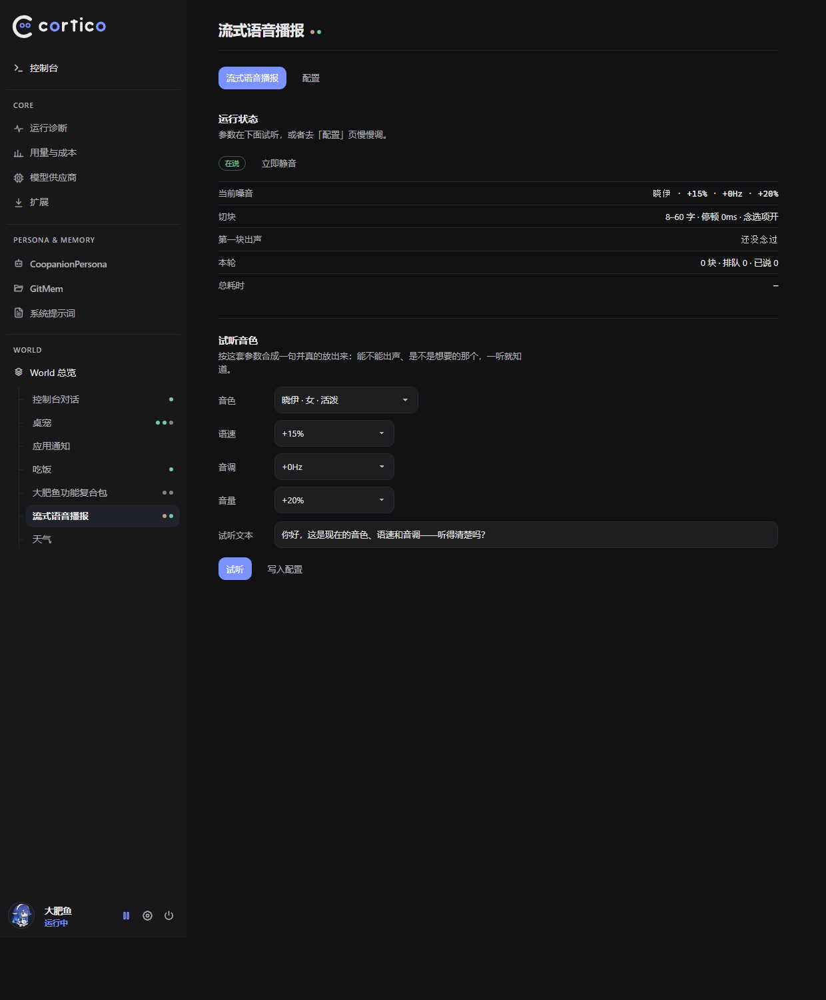

# 流式语音播报（cortico-world-streamvoice）

宠物还在写，第一句已经出声了。

本扩展**独立工作**：音色、语速、音调、音量、念哪些内容、切块长短、块间停顿，全是它自己的配置
（`worlds.streamvoice`），不读任何别的扩展的设置，也不依赖别的包才能跑。装上去、开起来，就有声音。

声音有两个来源，配置里一个开关切：**Edge 朗读接口**（开箱能用，29 个音色），或者**任何 OpenAI 兼容的
`/v1/audio/speech` 服务**——本机 WSL 里的 Qwen3-TTS、CosyVoice、GPT-SoVITS、vLLM 起的都能接。
换引擎只改 `worlds.streamvoice.engine`，两条路共用同一套切块、排队、打断、试听。



旧的整段朗读要等台词全部写完、记进事件库，再靠轮询捞出来，整段合成、整段播放。
这个扩展换了个口子：World 可以声明 `outputTap()`，框架把主 session 的模型输出增量直接扇过来，
于是第一句一写完就能去合成，后面的句子边生成边排队，播放器一块接一块地说。

## 它怎么工作

```
模型输出增量
  └─ response.output_item.added         认出 pet_say / pet_ask / pet_quiet
       └─ …function_call_arguments.delta  JSON 碎片 → args.ts 抠出 script
            └─ clean.ts                  【动作】<表情> 标记去掉，表情/网址/Markdown 去掉
                 └─ chunker.ts           按句切块：短句并下一句，超长在逗号处再切
                      └─ speaker.ts      立刻合成（Edge 连接 / 自建 HTTP 服务）→ 播放器按顺序连播
```

- **订阅的是函数调用参数，不是正文。** 这个 bot 从不用 assistant 正文说话：说出来的一切都在
  `pet_say` 的 `script` 参数里（`pet_ask` 的 `question` 同理）。所以增量得从
  `response.function_call_arguments.delta` 里增量解 JSON，见 `src/args.ts`。
- **切块**：句末（。！？；换行 / 英文 `.!?;`）切一刀；短于 `chunkMinChars` 的句子并到下一句；
  一块超过 `chunkMaxChars` 就在靠后的逗号处再切，没标点就硬切。
- **合成与播放是两条流水线**：每块一进队就开始合成（互相串行，一条 Edge 连接），播放器只按顺序放。
  第 1 块在说的时候，第 2 块早就合成好了，块与块之间没有等待（实测衔接 0–30ms）。
- **预热**：Edge TTS 一条连接上的第一趟要 2–3.5 秒，热了以后只要几百毫秒。所以模型开始想第一句时
  先空打一发合成，把链路焐热，结果丢掉（可用 `prewarm` 关掉）。
- **清空队列**：新的一批送达（新回复）或被打断（`onAbort`）时，`hush()` 把代次加一：排队的块丢掉，
  正在合成的结果回来也丢掉，正在放的那一片杀掉播放器。模型调 `pet_quiet` 时同样清空；
  面板上的「立即静音」也走这条路。

## 装

三种装法，效果一样：扩展是纯 TS 源码 + 一份预构建的面板产物，**没有构建步骤**，
运行期只有一个依赖（`ws`，装的时候会一起下来）。

**最常见（从扩展市场）：** 打开控制台「World 扩展」页，搜「流式语音播报」或
`cortico-world-streamvoice`，点安装。市场按 npm 上的 `cortico-world` 关键字自动收录，
收录后卡片会带上图标、截图和「Voice」标签。

**给别人用（从 GitHub 拉）：**

```bash
cd <部署目录>/data/extensions
pnpm add github:laojingwei/cortico-world-streamvoice
```

**自己改（源码就在本机）：**

```bash
# 用 link: 装进去，改完重启 Core 就是新的
cd <部署目录>/data/extensions
pnpm add link:D:/dsh/workbuddy/extensions/cortico-world-streamvoice
```

`<部署目录>` 一般就是 Coopanion 的安装目录，比如 `E:/software/coopanion`。

然后打开它（`<部署目录>/data/home/companion/config.json` 里 `worlds.streamvoice.enabled` = true，
或在控制台「流式语音播报」页打开）。**只需要这一个开关**，别的扩展装不装、开不开都不影响。

如果机器上还装着别的会整段朗读的扩展（比如大肥鱼功能包、桌面宠物的语音库朗读）并且开着，
同一句会被念两遍——本扩展会在日志里点出是谁，面板上多一盏「另一处也在朗读」。把那边关掉即可。
这只是提醒，不是依赖。

## 发版

发版走 GitHub Actions 的 **trusted publishing**（OIDC）：runner 拿一次性令牌去 npm 换发布凭证，
仓库里不存任何 token，也不用管 2FA 验证码。工作流在 `.github/workflows/publish.yml`。

```bash
# 1. 改 package.json 的 version（改了 dist/webui.js 就必须升，面板按版本寻址）
# 2. 在 CHANGELOG.md 顶部加一条
git add -A && git commit -m "0.3.2：…"
git tag v0.3.2
git push origin main --tags        # 推 tag 就会触发发布
```

工作流会先核对 `package.json` 的版本和 tag 是否一致、该版本是否已存在，再 `npm publish --provenance`。
发布成功后 npm 包页面会带一个 provenance 徽章，能点开看到对应的 commit 和 workflow。

**首次配置（只做一次）**：打开 https://www.npmjs.com/package/cortico-world-streamvoice → 右侧
`Settings` → `Trusted Publisher` → 选 **GitHub Actions**，填：

| 字段 | 值 |
|---|---|
| Organization or user | `laojingwei` |
| Repository | `cortico-world-streamvoice` |
| Workflow filename | `publish.yml` |
| Environment name | 留空 |

环境名一旦填了，工作流里也得同步加 `environment: <名字>`，两边必须一致，否则 OIDC 换不到令牌。

应急时仍然可以在本地手发（需要 2FA 验证码）：`npm publish --registry=https://registry.npmjs.org --otp=<6位码>`。

## 三个页签

世界页顶部有五个页签：**流式语音播报 / Edge 语音 / API 语音 / 配置 / 环境提示词**。

前三个是扩展自己给的（`panels`），后两个是框架画的。想用哪套引擎就点哪一页，页内只有那一套
参数和一个「启用」开关——以前两套并排挤在「配置」里，谁也说不清哪一组此刻生效。

### 流式语音播报

只报状态：待命 / 在说 / 已关、当前引擎与嗓音、切块与停顿、第一块出声耗时、本轮块数 / 排队 /
已说 / 失败、本轮总耗时，外加「立即静音」。

### Edge 语音

启用开关 + 音色（下拉）+ 语速 / 音调 / 音量三个滑动条，初始值取当前配置。
下面可以改试听文本、按「试听这句」→ 服务端用**同一套合成链路**合成这一句并放出来，回来告诉你
「可以用 · 晓晓 · 合成 1.2s」，失败就说人话（比如「这个音色没能合成出来：Edge 朗读接口没有提供它」）。
**在这一页按试听就走 Edge，不用先启用**，也不会改动当前引擎。
满意就按「保存」，和「配置」页签写的是同一份值，下一句立即生效。

### API 语音

启用开关 + 服务地址（根地址）+ 访问令牌（密码框，掩着，留空＝不改，旁边可勾「清除令牌」）+
音色 / 模型 / 格式 / 语言 / 语气指令 / 语速倍率 / 播放音量 / 请求超时，以及「连接测试」。

1. 点「连接测试」：现问一遍 `<base>/models` 与 `<base>/audio/voices`，通了就把音色与模型换成下拉
   （选项就是后端此刻支持的清单，末项「其它（手填）」换回输入框），并告诉你
   「通 · 29ms · 10 个音色、1 个模型」；只有一个端点 404 说明后端没实现它，仍算连通，那一项保持手填。
   模型下拉第一项是「（不发送）」，表示请求里不带 `model`；
2. 音色与模型打开就是下拉，读的是探测缓存，不必先点测试；提示行会写「用的是 3 分钟前的清单」，
   点一次「连接测试」就刷新；
3. 按「试听这句」直接打你那个后端——**在这一页按就用这一页的配置**，不必先启用 API，也不会
   把引擎切过来；按「保存」才一次写全（地址、令牌、音色、模型、格式、语言、语气、倍率、音量、超时）。

**音量与语速都在本地做，两条引擎一致**：合成请求里只带音色（Edge 再加音调），语速和音量一概不发，
拿到原声之后在前端重算——音量是纯乘法增益（0.1–5 倍，最后一并钳到满刻度），语速是 WSOLA
波形相似重叠相加（0.1–5 倍，改快改慢都不跑调）。所以 API 后端支不支持 `speed` 都无所谓，
Edge 那边也不再受 SSML `volume` 只能往下压的限制。音调仍由引擎决定（Edge 走 SSML，API 只能靠语气指令）。

具体链路：解码（WAV 直接读 PCM，MP3 走 `mpg123-decoder` 的 WASM）→ WSOLA 变速 → 增益 → 重编码成
16 bit PCM WAV → 播放器。倍率都是 1 时三步全跳过，原文件直接交出去，不花一点算力。
遇到解不开的容器（Opus / FLAC / 无头 PCM）就原样播，音量语速退回引擎默认——不会因为处理失败没声音。

## 让模型自己调嗓音（工具）

除了人去点面板，模型也能自己动手——用户顺口说「说慢点」「声音小一点」「换个男声」的时候，
不必再让用户去翻控制台。本扩展给了三个工具：

| 工具 | 标签 | 作用 |
|---|---|---|
| `speech_status` | read / snapshot | 查当前的完整设置：嗓音四项、念什么、切块与节奏、预热与日志、总开关，以及此刻在不在说、队列几块 |
| `speech_tune` | write | 改**这个扩展的全部可调项**（见下表），和页签上改的是同一份值 |
| `speech_silence` | write | 立刻停掉正在念的和排队的，不改设置、不影响后面的新台词（整轮安静仍用 `pet_quiet`） |

`speech_tune` 的字段与配置项一一对应，一个不漏：

| 分类 | 字段 | 说明 |
|---|---|---|
| 引擎 | `engine` / `useEdge` / `useApi` | 引擎本身，或两个启用开关（开一个自动关另一个，和页签上同一套规则） |
| | `apiBase` / `apiKey` / `apiModel` | 服务根地址（整条端点会被截回根）、令牌（空串清空）、模型名 |
| | `apiVoice` / `apiFormat` | 后端音色名、要回的音频格式 |
| | `apiInstructions` / `apiLanguage` | 整段语气指令、语言 |
| `apiSpeedFactor` / `apiVolume` / `apiTimeoutMs` | 语速倍率 0.1–5、音量倍率 0.1–5（1 = 原值，本地处理不发给后端）、单块超时 |
| 嗓音 | `voice` | 中文名（晓晓、云希…）或 Edge ShortName，只在 Edge 引擎下有效 |
| | `rate` / `volume` | 语速与音量的倍率，0.1–5，**保留两位小数**，1 = 原速 / 原音量（本地 WSOLA / 增益） |
| | `pitch` | −50…50 Hz，自动对齐到 5（SSML 里是 `+20Hz`） |
| 念什么 | `readSay` / `readAsk` / `readOptions` | 台词、问句、选项三个开关 |
| 切块与节奏 | `chunkMinChars` / `chunkMaxChars` / `gapMs` | 参数范围与「配置」页签完全一致；上限被给到比门槛小时会自动抬高并在回执里说明 |
| 高级 | `prewarm` / `verbose` | 预热、详细日志 |
| 总开关 | `enabled` | 整个扩展开关。关掉后扩展停止工作，模型自己打不开，得人去控制台恢复 |

几个刻意的设计：

- **改的是长期配置**：`speech_tune` 走 `ctx.persist()` 写进 `worlds.streamvoice`，下一句就生效，
  重启也还在；页签上和工具改的是同一份值。
- **倍率保留两位**：模型给 `rate: 1.234`，落盘的是 `1.23`——滑动条步进 0.05，不会留下一个
  拖不到的位置；音调仍是 5Hz 一档（`pitch: 37` → `+35Hz`），因为它是 SSML 的厂商单位。
- **音色只认名单里的**：说「林黛玉」会被拒，回执里附几个可用的中文音色名让模型自己问清楚，
  免得换成一个合成不出来的音色、把声音搞哑。
- **回执讲清前因后果**：改完告诉模型「音色 晓晓 → 云希，语速 1× → 1.2×」，它才知道自己现在是什么声音。

不想让它自作主张：配置 → 高级 → 关掉 **允许模型自己调嗓音**（`allowSelfTuning`）。
关掉后 `speech_tune` 压根不出现在工具表里，模型看不到也就不会反复尝试；查看和停止仍然保留。

### 环境提示词（模型怎么知道自己能干什么）

光有工具声明不够——模型还需要一段环境说明，才知道「现在是什么声音」「这些设置意味着什么」
「什么时候该动手、什么时候该问」。所以包里有 `src/ENV_PROMPT.md`，作为本 World 的
`envPrompt` 模板随每次前缀重建发给模型，里面的值都是实时的：

```
现在的设置：合成引擎：Edge 朗读接口，音色 晓晓（zh-CN-XiaoxiaoNeural），语速 1×，音调 +0Hz，音量 1×。
嗓音 晓晓（zh-CN-XiaoxiaoNeural），语速 1×，音调 +0Hz，音量 1×。
念什么：台词开、问句开、选项开。
切块与节奏：短句并下一句的门槛 8 字，单块上限 60 字，块间停顿 0ms。
预热开、详细日志关、总开关开。
```

占位符一共 8 个（`{{ streamvoice.engine }}`、`.state`、`.content`、`.chunks`、`.switches`、`.canTune`、
`.voices`、`.otherReaders`），由 `envPromptVars()` 提供，改完配置下一次重建就是新的。
切到 API 引擎后 `.engine` 会带上端点、音色、格式，`.voices` 换成后端那套名字。

**可以直接改**：控制台 → 提示词页 → 「环境提示词」，编辑后保存到
`<部署目录>/worlds/streamvoice/ENV_PROMPT.md`，框架优先读这份覆盖文件，清空即回落到包内默认。
想让它更话痨或更寡言、想加自己的语气要求（比如「别老问我要不要换音色」），改这里就行，
不用碰代码。注意占位符要原样留着，删掉它们模型就看不到当前设置了。

自测：`scripts/check-tools.ts` 验参数翻译（口语名、倍率对齐、非法值），
`scripts/check-world-tools.ts` 真的 `new` 一个 World 出来调那三个工具，并检查
`ENV_PROMPT.md` 里每个占位符都有值、渲染后没有残留 `{{ }}`；
`scripts/check-audio.ts` 验音频管线——合成的正弦波放 2 倍音量后峰值是不是正好翻倍、变速 2 倍后
帧数是不是减半、默认值是不是原样返回，最后再连一次 Edge 拿真 MP3 走一遍解码。

## 配置（改完下一句生效，不用重启）

两套引擎各占一个页签（「Edge 语音」「API 语音」），页内顶上就是它自己的启用开关；「配置」页签
只剩下念什么、切块与节奏、高级。开一边自动关另一边（`engine` 跟着变），所以切引擎不用刷新页面。

> 这两个页签由扩展自己画，所以保存走页签自己的 `save` 方法（框架的 `/api/config` 只认
> 「配置」页签里声明过的组）。校验规则与 schema 里写的一致：枚举候选、数值范围、地址规范化。

### 启用开关

| 键 | 默认 | 说明 |
|---|---|---|
| `useEdge` | `false` | 「Edge 语音」组的启用开关；打开就把 `engine` 切成 `edge`，并关掉 `useApi` |
| `useApi` | `false` | 「API 语音」组的启用开关；打开就把 `engine` 切成 `api`，并关掉 `useEdge` |

真正决定声音来源的是 `engine`（`edge` / `api`），开关只是它的两个把手：两个都关着时保持现有引擎
并点亮对应那侧，两个都开着（刚打开另一边）时切到另一边。模型用 `speech_tune` 改 `useEdge` / `useApi`
也是同一套规则。

### 语音 API（「API 语音」页签）

| 键 | 默认 | 说明 |
|---|---|---|
| `apiBase` | `http://127.0.0.1:8091/v1` | **服务根地址**（OpenAI 说的 `base_url`）。只写主机名会自动补 `/v1`；把整条 `/v1/audio/speech` 贴进来也能认，会截回根地址 |
| `apiVoice` | `vivian` | 后端音色名，**动态下拉**：选项来自最近一次探测（启动时自动探一次并缓存），名字后面带说明，如 `serena — 温暖、柔和的年轻女声 · 中文` |
| `apiModel` | 空 | OpenAI 协议的 `model` 字段，同样是动态下拉；第一项「（不发送）」，选它就不带这一项 |
| `apiFormat` | `wav` | `mp3` / `wav` / `flac` / `opus` / `pcm`（`pcm` 无头，播不出来）。`wav` 解码最省事；选 `mp3` 也能放大变速——本地先用 WASM 解码再处理，格式只影响解码这一步 |
| `apiInstructions` | 空 | 整段共用的语气指令，如「用开心的语气说」「语速偏慢、语气温柔」 |
| `apiLanguage` | 空 | `Chinese` / `English` / …；留空让后端判断 |
| `apiSpeedFactor` | `1` | 语速倍率 0.1–5（步进 0.05），1 是原速。**不发给后端**，本地 WSOLA 变速、保音调 |
| `apiVolume` | `1` | 播放音量倍率 0.1–5（步进 0.05），1 是原音量。本地乘法增益，先算进音频再交给播放器，不改变音色、也不发给后端 |
| `apiTimeoutMs` | `30000` | 单块合成的超时；卡住就跳过这一块，不影响后面 |

探测到的清单缓存在 `worlds.streamvoice.apiCatalog`（`{ base, at, voices, models }`），
「API 语音」页签读它，所以**打开就能选，不用每次点「连接测试」**；地址一改缓存作废并自动重探。

访问令牌 `apiKey` 不在「配置」页签里：那里只能画明文输入框。它只在「API 语音」页签以密码框出现
（留空＝不改，勾「清除令牌」＝清空），存进 `config.json`，请求时按 `Authorization: Bearer` 发。

接口路径按规范自己拼，所以换后端一般只改根地址：

| 用途 | 路径 |
|---|---|
| 合成 | `POST <base>/audio/speech` |
| 模型清单 | `GET <base>/models`（OpenAI 规范） |
| 音色清单 | `GET <base>/audio/voices`（不是标准端点，认不出来就当没有） |

其他后端要手动写接口地址时，只要它抄的是 OpenAI 那套请求体（`input` / `voice` / `response_format`，可选
`model` / `instructions` / `language` / `speed`），直接填根地址就能用。

**接自建服务**：

1. 在「API 语音」页签打开「启用 API 语音」（「Edge 语音」那边的开关会自动关掉）；
2. 面板上填服务地址（默认 `127.0.0.1:8091/v1`），按 **连接测试**——通了会把服务提供的音色、模型换成下拉，
   直接选，不用背名字；地址被规范化了也会回填；
3. 按「试听」。出声就成了；不出声看那条红字，它直接说是连不上、404 端点不对、还是 400 音色不存在。

手测后端本身：

```bash
curl -X POST http://127.0.0.1:8091/v1/audio/speech \
  -H "Content-Type: application/json" \
  -d '{"input":"你好，欢迎使用语音合成。","voice":"vivian","instructions":"用开心的语气说"}' \
  --output out.wav

curl http://127.0.0.1:8091/v1/audio/voices   # 看这个后端有哪些音色
curl http://127.0.0.1:8091/v1/models         # 看它有哪些模型
```

> `engine = api` 时 `voice` / `rate` / `pitch` / `volume` 不生效——那是 Edge 的四个参数（在「Edge 语音」页签里改）。
> 想变速用 `apiSpeedFactor`，或在 `apiInstructions` 里写「说得慢一点」走模型自己的韵律。
> 两者不冲突：`apiSpeedFactor` 只改时长、不动音调，想连语气一起慢下来才用语气指令。
> 切回 `edge` 时原来的嗓音还在，不用重设。

### 嗓音（`engine = edge` 时生效）

| 键 | 默认 | 说明 |
|---|---|---|
| `voice` | `zh-CN-XiaoxiaoNeural` | Edge 朗读接口的音色 ShortName，下拉 29 个（中/粤/台/英/日/韩），都已实测能出声 |
| `rate` | `1` | 语速倍率 0.1–5，步进 0.05；1 是原速，2 是两倍快。本地 WSOLA 变速，改快改慢都不跑调 |
| `pitch` | `+0Hz` | 音调，5Hz 一档，-50Hz…+50Hz（21 档）；负数更低沉，正数更明亮。**唯一还发给引擎的参数** |
| `volume` | `1` | 音量倍率 0.1–5，步进 0.05；1 是原音量，5 是顶到满刻度。本地乘法增益，音色不变 |

### 念什么

| 键 | 默认 | 说明 |
|---|---|---|
| `readSay` | `true` | 念 `pet_say` 的台词 |
| `readAsk` | `true` | 念 `pet_ask` 的问题 |
| `readOptions` | `true` | 问句把可选的答案也念出来 |

### 切块与节奏

| 键 | 默认 | 说明 |
|---|---|---|
| `chunkMinChars` | `8` | 短于这么多字的一句并到下一句；调小第一声更快 |
| `chunkMaxChars` | `60` | 一块最多这么多字，超过在逗号处再切 |
| `gapMs` | `0` | 一块说完后额外停多久（0–3000ms），嫌说得太赶可以加几十毫秒 |

### 高级

| 键 | 默认 | 说明 |
|---|---|---|
| `prewarm` | `true` | 模型开始写时先空合成一声预热连接；关掉省一次请求，但第一句会慢 2 秒左右 |
| `verbose` | `false` | 把每一块的合成耗时都写进日志；关掉只留第一块那行 |
| `allowSelfTuning` | `true` | 允许模型用 `speech_tune` 自己改嗓音；关掉后该工具不再出现在工具表里 |

### 挂载开关

| 键 | 默认 | 说明 |
|---|---|---|
| `enabled` | `false` | 框架的挂载开关。关掉 = 本扩展完全不工作 |

## 关掉退回原样

```json
"worlds": { "streamvoice": { "enabled": false } }
```

World 不挂载，接收器也就不存在，框架不再把增量扇过来；原来负责朗读的扩展照旧走它自己的路径
（整段台词写完 → 事件库 → 轮询 → 整段合成播放）。

## 面板实现

`dist/webui.js` 是手写 ESM，无依赖，导出 `{ panels: { stream, 'edge-voice', 'api-voice' } }`。

- 字段表由后端给：`invoke('fields')` 返回 `{ group, title, desc, fields: [{ key, type, title, desc,
  value, options, min, max, suffix, placeholder }] }`，文案与选项全在 `src/config.ts`。前端只按 `type`
  摆控件，不认识任何字段名——以后加参数只改后端一处。
- 保存走 `invoke('save', [values])`，写的是同一份 `worlds.streamvoice`；「启用」开关改动即生效，
  其余字段按「保存」。
- 试听走 `invoke('preview', [...])`，用的是**页面上此刻的值**（还没保存也能听），
  并且**引擎由页签决定**（`edge-voice` → Edge，`api-voice` → API），与「启用」开关无关。

顶部两盏灯：流式朗读（待命/正在说/出错）、嗓音（当前用的是哪个）；只有真的还有别人在朗读时，
才多出第三盏「另一处也在朗读」。

> 面板产物按包版本寻址（`/assets/extensions/<包>/<版本>/webui.js`），改了 `dist/webui.js`
> 记得同时升 `package.json` 的 `version` 并重启 Core，否则浏览器会拿旧的那份。

## 自测

```bash
TSX="node E:/software/coopanion/resources/app/node_modules/tsx/dist/cli.mjs"

# 切块/参数流/标记清理的单元自测（不出声）
$TSX scripts/check-chunker.ts

# 合成与连播的时序（会真的出声）
$TSX scripts/check-speaker.ts

# 把整张音色表逐个合成一遍，列出哪个不可用（会依次出声）
$TSX scripts/check-voices.ts

# API 引擎联调：地址规范化、连接测试、合成与 speed；服务没起就跳过。只合成不播放
$TSX scripts/check-api.ts

# 工具与 World 层：参数翻译、改配置、提示词占位符（不连网、不出声）
$TSX scripts/check-tools.ts
$TSX scripts/check-world-tools.ts

# 让 Coo 真的回一段（Coopanion 正在运行时；没设控制台密码时不用登录）
$TSX scripts/send-chat.ts "用一段话说说今天适合做什么"
```

实测看 `data/logs/core.log` 里 `worlds.streamvoice` 的行：`切出第 1 块（… 开写后 Xms）`、
`第 1 块出声（切出后 Yms…）`；试听会留一行 `试听（Edge 朗读/API 服务）<声音>：可用/失败`。
第一块出声的时刻早于 `pet_say 写完`，就是提前出声。

## 依赖与授权

- 运行期只依赖一个 `ws`（`src/edge-tts/` 用它连 Edge TTS 的 WebSocket 接口），其余全是 Node 内置模块；
  API 引擎用的是 Node 内置 `fetch`，不需要额外包；合成出来的音频走 Windows 的 winmm MCI（常驻 PowerShell）
  或 macOS 的 `afplay` 播放。
- `src/edge-tts/` 是 msedge-tts v2.1.0 的客户端源码拷贝，MIT，版权 Migushthe2nd：
  上游带 `preinstall: only-allow pnpm`，pnpm 装不上，所以自带一份。**这是代码来源，不是运行期依赖。**
- `scripts/` 下几个自测脚本历史上用 tsx 直接跑 `.ts`；`pnpm check` / `check:speaker` / `check:voices`
  已经把它们包好了，不装 tsx 也可以照下面「自测」里的绝对路径方式跑。
- 扩展本体 AGPL-3.0-or-later。
