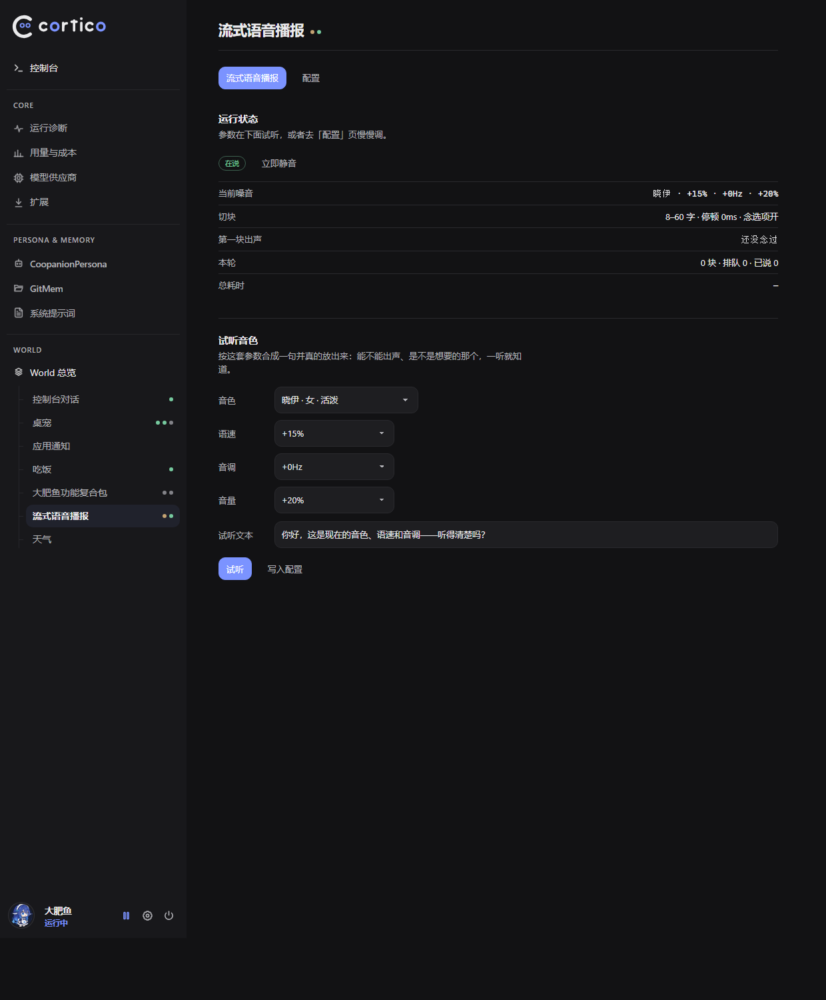

# 流式语音播报（cortico-world-streamvoice）

宠物还在写，第一句已经出声了。

本扩展**独立工作**：音色、语速、音调、音量、念哪些内容、切块长短、块间停顿，全是它自己的配置
（`worlds.streamvoice`），不读任何别的扩展的设置，也不依赖别的包才能跑。装上去、开起来，就有声音。



旧的整段朗读要等台词全部写完、记进事件库，再靠轮询捞出来，整段合成、整段播放。
这个扩展换了个口子：World 可以声明 `outputTap()`，框架把主 session 的模型输出增量直接扇过来，
于是第一句一写完就能去合成，后面的句子边生成边排队，播放器一块接一块地说。

## 它怎么工作

```
模型输出增量
  └─ response.output_item.added         认出 pet_say / pet_ask / pet_quiet
       └─ …function_call_arguments.delta  JSON 碎片 → args.ts 抠出 script
            └─ clean.ts                  【动作】<表情> 标记去掉，表情/网址/Markdown 去掉
                 └─ chunker.ts           按句切块：短句并下一句，超长在逗号处再切
                      └─ speaker.ts      立刻合成（与播放流水线并行）→ 播放器按顺序连播
```

- **订阅的是函数调用参数，不是正文。** 这个 bot 从不用 assistant 正文说话：说出来的一切都在
  `pet_say` 的 `script` 参数里（`pet_ask` 的 `question` 同理）。所以增量得从
  `response.function_call_arguments.delta` 里增量解 JSON，见 `src/args.ts`。
- **切块**：句末（。！？；换行 / 英文 `.!?;`）切一刀；短于 `chunkMinChars` 的句子并到下一句；
  一块超过 `chunkMaxChars` 就在靠后的逗号处再切，没标点就硬切。
- **合成与播放是两条流水线**：每块一进队就开始合成（互相串行，一条 Edge 连接），播放器只按顺序放。
  第 1 块在说的时候，第 2 块早就合成好了，块与块之间没有等待（实测衔接 0–30ms）。
- **预热**：Edge TTS 一条连接上的第一趟要 2–3.5 秒，热了以后只要几百毫秒。所以模型开始想第一句时
  先空打一发合成，把链路焐热，结果丢掉（可用 `prewarm` 关掉）。
- **清空队列**：新的一批送达（新回复）或被打断（`onAbort`）时，`hush()` 把代次加一：排队的块丢掉，
  正在合成的结果回来也丢掉，正在放的那一片杀掉播放器。模型调 `pet_quiet` 时同样清空；
  面板上的「立即静音」也走这条路。

## 装

两种装法，效果一样：扩展是纯 TS 源码 + 一份预构建的面板产物，**没有构建步骤**，
运行期只有一个依赖（`ws`，装的时候会一起下来）。

**给别人用（从 GitHub 拉）：**

```bash
cd <部署目录>/data/extensions
pnpm add github:laojingwei/cortico-world-streamvoice
```

**自己改（源码就在本机）：**

```bash
# 用 link: 装进去，改完重启 Core 就是新的
cd <部署目录>/data/extensions
pnpm add link:D:/dsh/workbuddy/extensions/cortico-world-streamvoice
```

`<部署目录>` 一般就是 Coopanion 的安装目录，比如 `E:/software/coopanion`。

然后打开它（`<部署目录>/data/home/companion/config.json` 里 `worlds.streamvoice.enabled` = true，
或在控制台「流式语音播报」页打开）。**只需要这一个开关**，别的扩展装不装、开不开都不影响。

如果机器上还装着别的会整段朗读的扩展（比如大肥鱼功能包、桌面宠物的语音库朗读）并且开着，
同一句会被念两遍——本扩展会在日志里点出是谁，面板上多一盏「另一处也在朗读」。把那边关掉即可。
这只是提醒，不是依赖。

## 试听音色（面板）

「流式语音播报」页签的第二张卡可以**现场试听**：

1. 选音色、语速、音调、音量（下拉就是配置里那几组选项，默认取当前配置）；试听文本也能改；
2. 按「试听」→ 服务端用**同一套合成链路**合成这一句并放出来，返回「可以用 · 彩云 · 合成 1.2s」，
   或者把失败原因写成一句人话（比如「这个音色没能合成出来：Edge 朗读接口没有提供它」）；
3. 满意就按「写入配置」，和配置页是同一份值，下一句立即生效。

因为试听走的就是正式朗读的那条路（同样的音色/语速/音调/音量、同样的播放器），
**它能不能出声就等于正式朗读能不能出声**；`scripts/check-voices.ts` 会把整张音色表跑一遍。

## 配置（都在控制台「流式语音播报 → 配置」页，改完下一句生效，不用重启）

### 嗓音

| 键 | 默认 | 说明 |
|---|---|---|
| `voice` | `zh-CN-XiaoxiaoNeural` | Edge TTS 音色 ShortName，下拉 29 个（中/粤/台/英/日/韩），都已实测能出声 |
| `rate` | `+0%` | 相对语速，5% 一档，-50%…+50%（21 档） |
| `pitch` | `+0Hz` | 音调，5Hz 一档，-50Hz…+50Hz（21 档）；负数更低沉，正数更明亮 |
| `volume` | `+0%` | 相对音量，5% 一档，-50%…+50%（21 档） |

### 念什么

| 键 | 默认 | 说明 |
|---|---|---|
| `readSay` | `true` | 念 `pet_say` 的台词 |
| `readAsk` | `true` | 念 `pet_ask` 的问题 |
| `readOptions` | `true` | 问句把可选的答案也念出来 |

### 切块与节奏

| 键 | 默认 | 说明 |
|---|---|---|
| `chunkMinChars` | `8` | 短于这么多字的一句并到下一句；调小第一声更快 |
| `chunkMaxChars` | `60` | 一块最多这么多字，超过在逗号处再切 |
| `gapMs` | `0` | 一块说完后额外停多久（0–3000ms），嫌说得太赶可以加几十毫秒 |

### 高级

| 键 | 默认 | 说明 |
|---|---|---|
| `prewarm` | `true` | 模型开始写时先空合成一声预热连接；关掉省一次请求，但第一句会慢 2 秒左右 |
| `verbose` | `false` | 把每一块的合成耗时都写进日志；关掉只留第一块那行 |

### 挂载开关

| 键 | 默认 | 说明 |
|---|---|---|
| `enabled` | `false` | 框架的挂载开关。关掉 = 本扩展完全不工作 |

## 关掉退回原样

```json
"worlds": { "streamvoice": { "enabled": false } }
```

World 不挂载，接收器也就不存在，框架不再把增量扇过来；原来负责朗读的扩展照旧走它自己的路径
（整段台词写完 → 事件库 → 轮询 → 整段合成播放）。

## 面板

控制台「流式语音播报」页签（`dist/webui.js`，手写 ESM，无依赖）有两张卡：

- **运行状态**：待命 / 在说 / 已关、当前嗓音、切块与停顿、第一块出声耗时、本轮块数 / 排队 / 已说 / 失败、
  本轮总耗时，以及「立即静音」；
- **试听音色**：见上文。

顶部两盏灯：流式朗读（待命/正在说/出错）、嗓音（当前用的是哪个）；只有真的还有别人在朗读时，
才多出第三盏「另一处也在朗读」。

> 面板产物是按包版本寻址的（`/assets/extensions/<包>/<版本>/webui.js`），改了 `dist/webui.js`
> 记得同时升 `package.json` 的 `version` 并重启 Core，否则浏览器会拿旧的那份。

## 自测

```bash
TSX="node E:/software/coopanion/resources/app/node_modules/tsx/dist/cli.mjs"

# 切块/参数流/标记清理的单元自测（不出声）
$TSX scripts/check-chunker.ts

# 合成与连播的时序（会真的出声）
$TSX scripts/check-speaker.ts

# 把整张音色表逐个合成一遍，列出哪个不可用（会依次出声）
$TSX scripts/check-voices.ts

# 让 Coo 真的回一段（Coopanion 正在运行时；没设控制台密码时不用登录）
$TSX scripts/send-chat.ts "用一段话说说今天适合做什么"
```

实测看 `data/logs/core.log` 里 `worlds.streamvoice` 的行：`切出第 1 块（… 开写后 Xms）`、
`第 1 块出声（切出后 Yms…）`；试听会留一行 `试听 <音色> <语速> <音调> <音量>：可用/失败`。
第一块出声的时刻早于 `pet_say 写完`，就是提前出声。

## 依赖与授权

- 运行期只依赖一个 `ws`（`src/edge-tts/` 用它连 Edge TTS 的 WebSocket 接口），其余全是 Node 内置模块；
  合成出来的 mp3 走 Windows 的 winmm MCI（常驻 PowerShell）或 macOS 的 `afplay` 播放。
- `src/edge-tts/` 是 msedge-tts v2.1.0 的客户端源码拷贝，MIT，版权 Migushthe2nd：
  上游带 `preinstall: only-allow pnpm`，pnpm 装不上，所以自带一份。**这是代码来源，不是运行期依赖。**
- `scripts/` 下几个自测脚本历史上用 tsx 直接跑 `.ts`；`pnpm check` / `check:speaker` / `check:voices`
  已经把它们包好了，不装 tsx 也可以照下面「自测」里的绝对路径方式跑。
- 扩展本体 AGPL-3.0-or-later。
